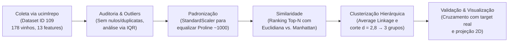
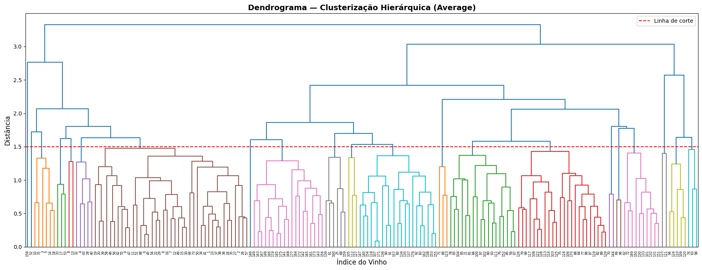
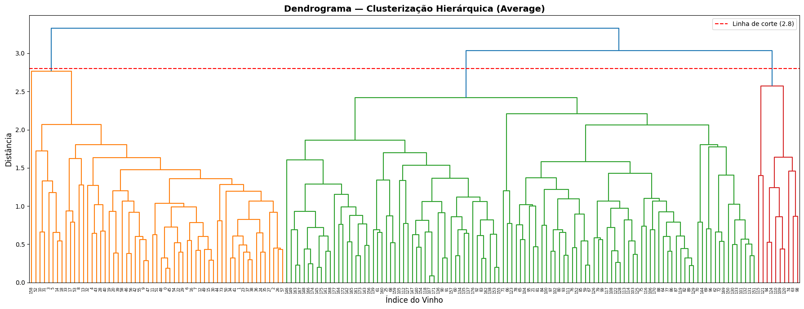
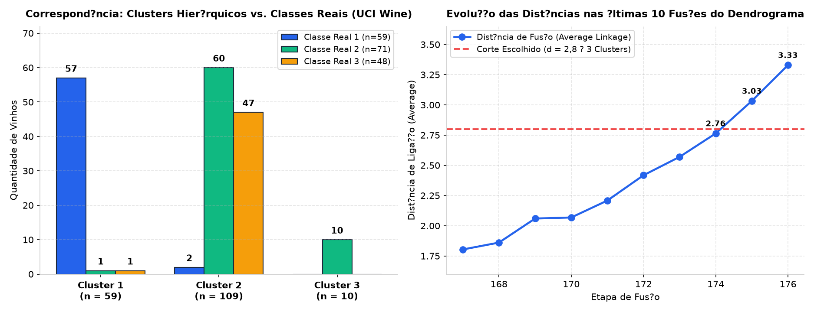
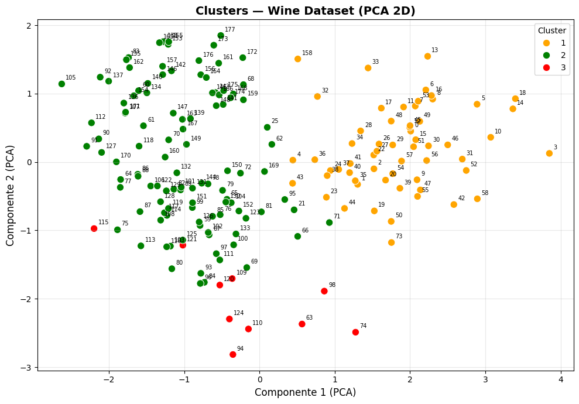

# Análise de Clusterização Hierárquica do Dataset Wine (UCI)


Projeto acadêmico da disciplina de **Modelos Descritivos** (Especialização em Engenharia e Análise de Dados — **CESAR School**), desenvolvido pela **Equipe 04 (Sala 4)**.

O estudo realiza a exploração estatística, investigação de *outliers*, padronização de variáveis, comparação entre métricas de distância (**Euclidiana vs. Manhattan**) e **Clusterização Hierárquica Aglomerativa** com ligação média (*average linkage*) sobre o clássico conjunto de dados [**Wine** (UCI Machine Learning Repository — ID 109)](https://archive.ics.uci.edu/dataset/109/wine), comparando os agrupamentos formados com as três cultivares reais de vinhos italianos (`target`).

---

## Sumário

1. [Visão Geral e Fluxo Metodológico](#1-visão-geral-e-fluxo-metodológico)
2. [Conjunto de Dados e Atributos Químicos](#2-conjunto-de-dados-e-atributos-químicos)
3. [Exploração, Outliers e Padronização](#3-exploração-outliers-e-padronização)
4. [Medidas de Distância e Similaridade (Euclidiana vs. Manhattan)](#4-medidas-de-distância-e-similaridade-euclidiana-vs-manhattan)
5. [Clusterização Hierárquica e Análise do Dendrograma](#5-clusterização-hierárquica-e-análise-do-dendrograma)
6. [Avaliação dos Clusters vs. Classes Reais (`target`)](#6-avaliação-dos-clusters-vs-classes-reais-target)
7. [Estrutura do Repositório](#7-estrutura-do-repositório)
8. [Como Executar](#8-como-executar)
9. [Equipe](#9-equipe)

---

## 1. Visão Geral e Fluxo Metodológico

O pipeline desenvolvido no notebook [`Atividade 01 - Cluesterização.ipynb`](./Atividade_01_Clusterizacao_Wine_UCI.ipynb) segue seis etapas estruturadas:



---

## 2. Conjunto de Dados e Atributos Químicos

O dataset **Wine** (UCI ID 109) resulta da análise química de **178 vinhos** cultivados na mesma região da Itália, mas derivados de **3 cultivares diferentes** (`target` $\in \{1, 2, 3\}$):
- **Classe 1:** 59 amostras
- **Classe 2:** 71 amostras
- **Classe 3:** 48 amostras

| # | Atributo Químico | Descrição | Papel na Clusterização |
| :-: | :--- | :--- | :--- |
| 1 | **`Alcohol`** | Teor alcoólico | **Selecionada para o agrupamento hierárquico** |
| 2 | `Malicacid` | Ácido málico | Explorada na análise descritiva e de *outliers* |
| 3 | `Ash` | Cinzas | Explorada na análise descritiva e de *outliers* |
| 4 | `Alcalinity_of_ash` | Alcalinidade das cinzas | Explorada na análise descritiva e de *outliers* |
| 5 | `Magnesium` | Magnésio | Explorada na análise descritiva e de *outliers* |
| 6 | **`Total_phenols`** | Fenóis totais | **Selecionada para o agrupamento hierárquico** |
| 7 | `Flavanoids` | Flavonoides | Explorada na análise descritiva |
| 8 | **`Nonflavanoid_phenols`** | Fenóis não flavonoides | **Selecionada para o agrupamento hierárquico** |
| 9 | `Proanthocyanins` | Proantocianidinas | Explorada na análise descritiva |
| 10 | `Color_intensity` | Intensidade de cor | Explorada na análise descritiva |
| 11 | `Hue` | Matiz (tonalidade) | Explorada na análise descritiva |
| 12 | `0D280_0D315_of_diluted_wines` | Razão de absorbância $\text{OD}_{280}/\text{OD}_{315}$ | Explorada na análise descritiva |
| 13 | **`Proline`** | Prolina (aminoácido, escala ~278 a 1.680) | **Selecionada para o agrupamento hierárquico** |

---

## 3. Exploração, Outliers e Padronização

1. **Qualidade dos Dados:** Nenhuma observação ausente (`0` nulos) e nenhuma linha duplicada (`0` duplicatas) nas 178 amostras.
2. **Inspeção de Outliers por IQR:** Embora algumas variáveis apresentem valores extremos segundo o critério dos quartis ($Q_1 - 1{,}5\cdot\text{IQR}$ e $Q_3 + 1{,}5\cdot\text{IQR}$), a inspeção conjunta em escala normalizada mostrou tratarem-se de variações químicas legítimas das safras, optando-se por **manter todas as 178 observações**.
3. **Necessidade Crítica de Padronização (`StandardScaler`):** A variável `Proline` atinge valores na casa de $1.000+$, enquanto `Nonflavanoid_phenols` varia em torno de $0{,}13$–$0{,}66$. Sem padronização ($\mu = 0, \sigma = 1$), o cálculo de distância seria integralmente dominado por `Proline`.

---

## 4. Medidas de Distância e Similaridade (Euclidiana vs. Manhattan)

Para construir um sistema de recomendação baseado no vinho mais próximo (Top-$N$ similares) a partir do perfil químico (`Alcohol`, `Total_phenols`, `Nonflavanoid_phenols`, `Proline`), foram comparadas duas métricas sobre os dados padronizados:

| Métrica | Fórmula Matemática | Comportamento Observado nos Vinhos |
| :--- | :---: | :--- |
| **Distância Euclidiana ($L_2$)** | $d_E(\mathbf{x}, \mathbf{y}) = \sqrt{\sum_{i=1}^p (x_i - y_i)^2}$ | Por elevar as diferenças ao quadrado, **penaliza severamente** vinhos que divergem muito em um único atributo químico, afastando-os no ranking. |
| **Distância de Manhattan ($L_1$)** | $d_M(\mathbf{x}, \mathbf{y}) = \sum_{i=1}^p \lvert x_i - y_i \rvert$ | Soma diferenças absolutas de forma linear, distribuindo o peso igualmente entre as colunas e mantendo próximos vinhos com pequenas variações distribuídas. |

---

## 5. Clusterização Hierárquica e Análise do Dendrograma

Utilizando o método de ligação média (**`average` linkage**) sobre as 4 variáveis selecionadas padronizadas, construiu-se a árvore hierárquica das 177 fusões:

### 5.1. Dendrograma Completo e Escolha do Ponto de Corte ($d = 2{,}8$)
Analisando as últimas 10 fusões da matriz de ligação, observa-se que os saltos de distância são graduais e os maiores incrementos ocorrem nas fusões **175 ($\Delta = 0{,}2688$, $d = 3{,}0329$)** e **176 ($\Delta = 0{,}2964$, $d = 3{,}3292$)**. Adotou-se o **corte em $d = 2{,}8$**, preservando **3 clusters** interpretáveis e alinhados às 3 cultivares conhecidas do dataset (em contraste com um corte baixo como $d = 1{,}5$, que fragmentaria a base em microgrupos pouco informativos).

<p align="center">
  
</p>

<p align="center">
  
</p>

---

## 6. Avaliação dos Clusters vs. Classes Reais (`target`)

<p align="center">
  
</p>

### 6.1. Matriz de Contingência (Clusters $\times$ Cultivar Real)

| Cluster Gerado ($d = 2{,}8$) | Total de Vinhos | Classe Real `1` *(n=59)* | Classe Real `2` *(n=71)* | Classe Real `3` *(n=48)* | Diagnóstico do Agrupamento |
| :-: | :-: | :-: | :-: | :-: | :--- |
| **Cluster 1** | **59** | **57 (96,6%)** | 1 | 1 | Capturou com altíssima pureza os vinhos da **Cultivar 1**. |
| **Cluster 2** | **109** | 2 | **60** | **47** | Agrupou a maioria das **Cultivares 2 e 3**, indicando sobreposição nas 4 variáveis escolhidas. |
| **Cluster 3** | **10** | 0 | **10** | 0 | Isolou um subgrupo específico da **Cultivar 2** com perfil químico distinto. |

### 6.2. Visualização Bidimensional dos Grupos

<p align="center">
  
</p>

> **Nota Metodológica e Limitações:** A escolha de 3 grupos é exploratória. A sobreposição entre as classes 2 e 3 no Cluster 2 decorre do subconjunto de 4 variáveis utilizado (`Alcohol`, `Total_phenols`, `Nonflavanoid_phenols`, `Proline`); a inclusão de atributos discriminantes adicionais como `Flavanoids` e `Color_intensity` aumenta a separabilidade entre essas duas cultivares.

---

## 7. Estrutura do Repositório

```text
├── assets/                                    # Dendrogramas, gráficos de avaliação e projeção dos clusters
│   ├── comparacao_clusters_target.png
│   ├── dendrograma_completo.png
│   ├── dendrograma_corte_clusters.png
│   └── dispersao_clusters_pca_2d.png
├── Atividade 01 - Cluesterização.ipynb        # Notebook completo com código, análises e conclusões
├── .gitignore                                 # Exclusão de ambientes virtuais e arquivos temporários
├── requirements.txt                           # Dependências Python do projeto
└── README.md                                  # Documentação detalhada e visual
```

---

## 8. Como Executar

Recomendado: **Python 3.10** ou superior.

1. Clone este repositório e acesse a pasta:
   ```bash
   git clone https://github.com/pepsbr/analise-de-clusterizacao-do-dataset-de-wines.git
   cd analise-de-clusterizacao-do-dataset-de-wines
   ```
2. Instale as dependências:
   ```bash
   python -m pip install -r requirements.txt
   ```
3. Abra o notebook no Jupyter ou Google Colab e execute as células em ordem:
   ```bash
   jupyter notebook "Atividade 01 - Cluesterização.ipynb"
   ```
   > **Nota:** O notebook obtém os dados automaticamente do repositório oficial da UCI por meio do pacote `ucimlrepo` (dataset ID `109`).

---

## 9. Equipe

Trabalho desenvolvido pela **Equipe 04 (Sala 4)** — CESAR School:

- **Mauro Roberto Barbosa Cahu**
- **Pedro Paulo Sant'Anna Belo Ramos**
- **Renato Vasconcellos Bittencourt Neto**
- **Vinicius Dantas Batista da Silva**
